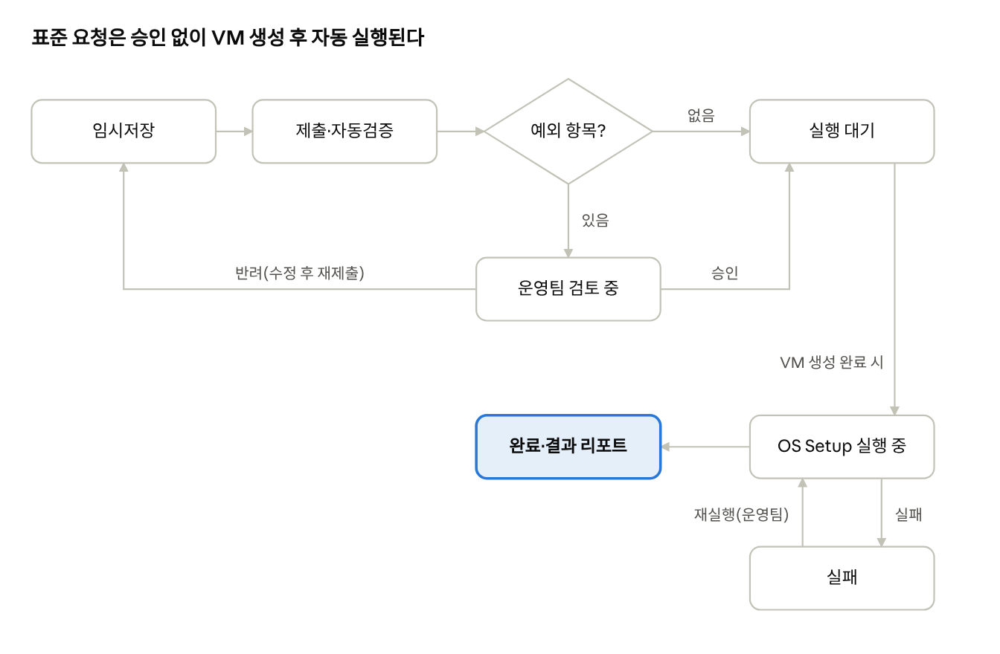

# OS Setup 셀프서비스 메뉴 설계 가이드 (2027)

2026-11-03 · 김동훈 · 원본 문서: https://claude.ai/artifact/QSADo6C6TJev79iD3BDQbz

## 1. 개요

2027년부터 고객이 Cloud 서비스 생성 사이트에서 VM을 만들 때 **OS·SW·계정 권한·스토리지·OS 파라미터·DB 접속정보를 직접 선택해 등록**하고, 그 데이터가 OS Setup 자동화로 바로 넘어가도록 "OS Setup 요청" 메뉴를 신설한다. 이 문서는 개발팀에 전달할 메뉴 구성과 설계 기준이다.

**배경.** 현재는 고객에게 설치요청서(문서)를 받아 담당자가 분석한 뒤, 내용을 호스트별 설정(env)으로 옮겨 VM 생성 후 OS 설치와 SW 설치를 수행한다. 요청서 수령·회신·재확인이 사람 사이를 오가고, 문서마다 표기가 달라 해석 오류와 누락이 생긴다.

**목표.**

- 별도 설치요청서 없이 포털 입력만으로 OS Setup 요청이 완결된다.
- 입력값은 표준 카탈로그(허용된 OS·SW·버전·파라미터)에서만 고르게 해, 설치 불가능한 조합을 등록 단계에서 막는다.
- 등록 데이터는 사람이 다시 옮겨 적지 않고 OS Setup 자동화의 입력(호스트 env)으로 그대로 변환된다.
- 진행 상태와 설치 결과를 고객이 포털에서 직접 확인한다.

**범위.**

| 구분 | 포함 | 제외 |
| --- | --- | --- |
| 메뉴 | OS Setup 신청(VM 생성 단계 통합), 요청 현황, 변경 요청, 카탈로그·승인 관리(운영자) | 기존 VM 생성·백업·스토리지 관리 메뉴 자체의 개편 |
| 데이터 | OS, 계정/권한, SW·버전, VG/LV·마운트, OS 파라미터, Oracle tnsnames | 애플리케이션 배포, DB 서버 구성 |
| 연동 | 포털 → OS Setup 실행 요청, 상태·결과 회신 | OS Setup 스크립트 내부 로직(운영팀 담당) |

**AS-IS → TO-BE.** 요청서 작성·전달·분석·옮겨 적기 단계가 포털 입력과 자동 검증으로 바뀐다. 담당자는 표준을 벗어난 예외 요청만 검토한다.

## 2. 메뉴 구성

신규 메뉴는 **기존 VM 생성 마법사 뒤에 "OS Setup" 단계를 이어 붙이는 방식**을 권장한다. 고객은 한 번의 신청으로 VM과 OS Setup을 함께 요청하고, 이미 만든 VM은 별도 "변경 요청" 메뉴로 추가 설치를 요청한다.

**기존 메뉴와의 관계.** VM 생성 메뉴에 이미 있는 항목(리전, 스펙, 디스크, 사용자/그룹, 홈 디렉터리, 서버 담당자)은 다시 입력받지 않는다. 신규 단계는 그 값을 불러와 보여주고, 없는 것(권한, SW, VG/LV·마운트 상세, OS 파라미터, tnsnames)만 추가로 받는다.

**OS Setup 신청 단계(마법사).**

1. OS 선택 — OS 종류·버전, 표준 설정(타임존, 로케일, SELinux)
2. 계정·권한 — 기존 사용자/그룹 불러오기 + UID/GID, 보조 그룹, sudo, limits
3. SW 선택 — 카탈로그에서 SW·버전·설치 계정 선택
4. 스토리지·마운트 — 기존 디스크 정의에 VG/LV/파일시스템/마운트 상세 추가
5. OS 파라미터 — 커널 파라미터(sysctl), 서비스, hosts
6. DB 접속(Oracle Client 선택 시에만 표시) — tnsnames 항목
7. 검토·제출 — 요약, 표준 예외 표시, 희망 완료일

**화면 목록.**

| 화면 ID | 화면명 | 사용자 | 주요 기능 |
| --- | --- | --- | --- |
| SET-01 | OS Setup 신청(마법사 1\~7단계) | 고객 | 입력, 임시저장, 실시간 검증, 제출 |
| SET-02 | 템플릿 | 고객 | 표준 템플릿(예: WEB, WAS, DB Client) 선택, 이전 요청 복제, 내 템플릿 저장 |
| SET-03 | 요청 현황·상세 | 고객, 운영팀 | 상태, 단계별 진행 로그, 설치 결과 리포트 |
| SET-04 | 변경 요청 | 고객 | 설치된 VM에 SW 추가, 파라미터·tnsnames 변경 |
| ADM-01 | 카탈로그 관리 | 운영팀 | OS·SW·버전·파라미터 허용값, 호환 매트릭스 |
| ADM-02 | 검토·승인 | 운영팀 | 예외 항목 검토, 반려(사유 입력), 승인 |
| ADM-03 | 실행 이력 | 운영팀 | 실행 로그 조회, 실패 단계 재실행 |

## 3. 화면별 입력 항목

모든 항목은 **자유 입력보다 카탈로그 선택을 우선**하고, 표준값을 미리 채워 고객은 바꿀 것만 바꾸게 한다. "자동화 변수" 열은 OS Setup의 호스트 env(`TARGET_*`)로 넘어갈 이름의 제안이며, 최종 명칭은 운영팀과 확정한다.

### 3.1 OS 선택

| 항목 | 입력 방식 | 필수 | 허용값·예시 | 자동화 변수(제안) |
| --- | --- | --- | --- | --- |
| OS 종류 | 드롭다운 | 예 | RHEL, Ubuntu | TARGET\_OS |
| OS 버전 | 드롭다운(종류에 따라 변경) | 예 | RHEL 8.x / 9.x / 10.x, Ubuntu 22.04 | TARGET\_OS\_VERSION |
| 타임존·로케일 | 드롭다운(기본값 표시) | 아니오 | Asia/Seoul, ko\_KR.UTF-8 등 | TARGET\_TZ, TARGET\_LOCALE |
| SELinux | 라디오 | 아니오 | enforcing / permissive / disabled (표준 외 값은 사유 필수) | TARGET\_SELINUX |

### 3.2 계정·권한

사용자·그룹·홈 디렉터리는 VM 생성 메뉴의 값을 그대로 표시하고, 아래는 계정별로 추가 입력한다.

| 항목 | 입력 방식 | 필수 | 허용값·예시 | 자동화 변수(제안) |
| --- | --- | --- | --- | --- |
| UID / GID | 숫자(미입력 시 자동 부여) | 아니오 | 1000 이상, 0 금지, 서버 내 중복 금지 | TARGET\_USERS\[\] |
| 보조 그룹 | 다중 선택 | 아니오 | dba, wheel 등(카탈로그) | TARGET\_USERS\[\].groups |
| 로그인 셸 | 드롭다운 | 아니오 | /bin/bash, /sbin/nologin | TARGET\_USERS\[\].shell |
| sudo 권한 | 라디오 + 명령 목록 | 아니오 | 없음 / 지정 명령만 / 전체(승인 필요) | TARGET\_SUDO\[\] |
| 리소스 제한(limits) | 항목 선택 + 값 | 아니오 | nofile, nproc, stack (상한 초과 시 경고) | TARGET\_LIMITS\[\] |
| 패스워드 | 입력받지 않음 | - | 초기 패스워드는 자동 생성 후 별도 채널로 전달(6장) | - |

### 3.3 SW 선택

| 항목 | 입력 방식 | 필수 | 허용값·예시 | 자동화 변수(제안) |
| --- | --- | --- | --- | --- |
| SW | 카드/체크 선택(다중) | 아니오 | JDK, Python, Oracle Client, SVN 등 카탈로그 등록분 | TARGET\_SW\[\] |
| 버전 | 드롭다운(선택한 OS와 호환되는 버전만) | 예(SW 선택 시) | 예: JDK 1.6.0\_37 / 1.8 / 17, Oracle Client 19.3.0.0 | sw\_mapping 키(예: oracle\_client\_19.3.0.0) |
| 기본 버전 | 라디오 | 조건부 | 같은 SW를 2개 버전 이상 선택했을 때 필수 | TARGET\_SW\[\].default |
| 설치 계정 | 드롭다운(3.2의 계정) | 조건부 | Oracle Client → oracle 계정 필수 | TARGET\_SW\[\].owner |
| 설치 경로 | 표시(표준 경로, 변경은 예외 요청) | 아니오 | 예: /oracle/CLIENT/oracle, /usr/local/java/jdk6 | TARGET\_ORACLE\_HOME, TARGET\_JAVA\_HOME |
| 환경변수 적용 범위 | 라디오 | 아니오 | 서버 전체(profile.d) / 지정 계정만 | TARGET\_SW\[\].env\_scope |

선행 패키지(예: JDK 6 → libnsl)는 고객이 고르지 않고 카탈로그에 정의해 자동 설치한다. 지원이 종료된 버전은 선택 시 경고와 사유 입력을 요구한다.

### 3.4 스토리지·마운트

VM 생성 메뉴에서 정의한 디스크를 목록으로 보여주고, 디스크별로 행을 추가해 입력한다.

| 항목 | 입력 방식 | 필수 | 허용값·예시 | 자동화 변수(제안) |
| --- | --- | --- | --- | --- |
| 디스크 | 선택(기존 정의) | 예 | 예: 데이터 디스크 1 (200GB) | TARGET\_DISKS\[\] |
| VG 이름 | 텍스트(명명 규칙 검사) | 예 | 예: datavg | TARGET\_LVM\[\].vg |
| LV 이름 / 크기 | 텍스트 / 숫자(GB) 또는 "남은 용량 전체" | 예 | 예: oralv / 50 | TARGET\_LVM\[\].lv, size |
| 파일시스템 | 드롭다운 | 예 | xfs(기본), ext4 | TARGET\_LVM\[\].fs |
| 마운트 포인트 | 텍스트 | 예 | 절대경로, 예: /oracle (/, /boot, /usr 등 시스템 경로 금지) | TARGET\_LVM\[\].mount |
| 소유자·권한 | 드롭다운 + 숫자 | 아니오 | oracle:dba, 750 | TARGET\_LVM\[\].owner, mode |
| 마운트 옵션 | 다중 선택 | 아니오 | defaults, noatime, nodev 등(카탈로그) | TARGET\_LVM\[\].opts |

### 3.5 OS 파라미터

| 항목 | 입력 방식 | 필수 | 허용값·예시 | 자동화 변수(제안) |
| --- | --- | --- | --- | --- |
| 커널 파라미터(sysctl) | 키 선택(카탈로그) + 값 | 아니오 | 예: kernel.shmmax, vm.swappiness, net.core.somaxconn (키별 최소/최대) | TARGET\_SYSCTL\[\] |
| 서비스 활성/비활성 | 목록 선택 | 아니오 | 카탈로그 등록 서비스만 | TARGET\_SERVICES\[\] |
| hosts 등록 | 행 추가(IP, 호스트명) | 아니오 | IP 형식 검사 | TARGET\_HOSTS\[\] |
| 기타 요청 | 자유 텍스트 | 아니오 | 카탈로그에 없는 요청 — 입력 시 자동으로 운영팀 검토 대상 | - |

### 3.6 DB 접속(tnsnames.ora)

Oracle Client를 선택했을 때만 표시한다. 항목을 행 단위로 받고, 기존 파일 업로드도 허용하되 업로드한 내용을 행으로 풀어 보여주고 문법을 검사한다.

| 항목 | 입력 방식 | 필수 | 허용값·예시 | 자동화 변수(제안) |
| --- | --- | --- | --- | --- |
| 별칭(Alias) | 텍스트 | 예 | 영문·숫자·\_ , 중복 금지 | TARGET\_TNS\[\].alias |
| HOST | 텍스트 | 예 | IP 또는 호스트명 | TARGET\_TNS\[\].host |
| PORT | 숫자 | 예 | 기본 1521 | TARGET\_TNS\[\].port |
| SERVICE\_NAME / SID | 라디오 + 텍스트 | 예 | 둘 중 하나 | TARGET\_TNS\[\].service |
| 파일 업로드 | 파일 | 아니오 | tnsnames.ora (파싱 실패 시 제출 불가) | - |

설치 후 별칭별 접속 점검 결과(별칭 해석, 리스너 응답)를 결과 리포트에 표시한다.

### 3.7 검토·제출

- 입력 전체 요약을 단계별로 보여주고, 표준과 다른 항목에 "예외" 표시를 붙인다.
- 예외 항목이 있으면 요청 사유를 필수로 받는다.
- 희망 완료일, 요청자·서버 담당자(기존 메뉴 값)를 확인한다.
- "템플릿으로 저장" 버튼을 둔다.

## 4. 검증 규칙과 카탈로그

설치 불가능한 요청은 **제출 전에 화면에서 막는다.** 검증 기준은 코드에 박지 말고 카탈로그 데이터로 두어, 운영팀이 개발 없이 SW·버전을 추가하거나 내릴 수 있게 한다.

### 4.1 검증 규칙

| 구분 | 규칙 | 시점 | 위반 시 |
| --- | --- | --- | --- |
| OS–SW 호환 | 선택한 OS 버전에서 지원되는 SW 버전만 목록에 노출 | 입력 중 | 선택 불가 |
| SW 선행 조건 | Oracle Client → oracle 계정·dba 그룹 존재, 설치 경로 마운트 존재 등 | 입력 중 | 해당 단계로 안내 |
| 계정 | UID 0 금지, UID/GID·계정명 중복 금지 | 입력 중 | 제출 불가 |
| sudo 전체 권한 | 사유 필수 | 제출 시 | 운영팀 승인 대상 |
| 스토리지 | LV 크기 합 ≤ 디스크 크기, 마운트 포인트 중복·시스템 경로 금지, VG/LV 명명 규칙 | 입력 중 | 제출 불가 |
| OS 파라미터 | 카탈로그 키만, 키별 최소/최대 | 입력 중 | 범위 밖 → 제출 불가 |
| tnsnames | 별칭 중복 금지, PORT 숫자, SERVICE\_NAME/SID 중 1개, 업로드 파일 문법 | 입력 중 | 제출 불가 |
| 지원 종료 버전 | 카탈로그 상태가 "신규 금지"인 SW | 입력 중 | 경고 + 사유 필수, 운영팀 승인 대상 |
| 기타 요청 | 자유 텍스트 입력 | 제출 시 | 운영팀 검토 대상 |

### 4.2 카탈로그(기준정보)

운영팀이 ADM-01에서 관리하며, 아래 항목을 가진다.

| 카탈로그 | 주요 속성 |
| --- | --- |
| OS | 종류, 버전, 표준 설정 기본값, 상태(사용 / 신규 금지 / 폐기) |
| SW | SW명, 버전, 설치 모듈 키(sw\_mapping\_linux.txt 키와 동일), 지원 OS 버전, 선행 패키지, 표준 경로, 필수 계정, 상태 |
| OS 파라미터 | 키, 설명, 기본값, 최소/최대, 적용 방식(sysctl / limits / 서비스) |
| 템플릿 | 이름, 포함 SW·파라미터·마운트 구성, 공개 범위(표준 / 개인) |

카탈로그의 "설치 모듈 키"는 OS Setup 프레임워크의 sw\_mapping 키와 한 쌍으로 관리해, 포털에 버전을 열면 설치 모듈도 준비돼 있어야 한다.

## 5. 상태 흐름과 OS Setup 연동

표준 범위 안의 요청은 **사람 승인 없이 VM 생성 완료 후 자동 실행**하고, 예외 항목이 있는 요청만 운영팀 검토를 거친다.



예외 항목이 있는 요청만 운영팀 검토를 거치고, 실행은 항상 VM 생성이 끝난 뒤 시작한다.

### 5.1 요청 상태

| 상태 | 의미 | 다음 상태 |
| --- | --- | --- |
| 임시저장 | 고객이 작성 중 | 제출 |
| 제출 | 검증 통과, 예외 여부 판단 | 검토 중(예외 있음) / 실행 대기(예외 없음) |
| 검토 중 | 운영팀이 예외 항목 검토 | 실행 대기(승인) / 반려(고객 수정 후 재제출) |
| 실행 대기 | VM 생성 완료를 기다림 | 실행 중 |
| 실행 중 | OS Setup 단계별 진행 | 완료 / 실패 |
| 실패 | 특정 단계 실패, 로그 표시 | 실행 중(운영팀 재실행) |
| 완료 | 결과 리포트 게시 | (변경 요청 시 새 요청 생성) |

### 5.2 연동 방식

포털은 요청을 **JSON 한 건**으로 OS Setup 실행 쪽에 넘기고, OS Setup은 이를 호스트 env(`config/env/<host>.env`)로 변환해 기존 setup\_sw.sh와 install\_\*.sh 모듈을 그대로 실행한다. 포털은 스크립트 내부를 알 필요가 없다.

| 방향 | 내용 | 방식(제안) |
| --- | --- | --- |
| 포털 → OS Setup | 요청 등록(실행 대기 진입 시) | REST `POST /os-setup/requests` |
| 포털 → OS Setup | VM 생성 완료 통보(호스트명, IP) | REST `POST /os-setup/requests/{id}/start` |
| OS Setup → 포털 | 단계별 상태·로그 요약 | 콜백 `PUT /portal/requests/{id}/status` |
| OS Setup → 포털 | 결과 리포트(설치 버전, 경로, 점검 결과) | 콜백, 리포트 파일 첨부 |

1단계에서 API가 어렵다면 포털이 JSON 파일을 내려받게 하고 운영팀이 실행하는 방식으로 시작해도 된다(7장).

### 5.3 요청 데이터 예시

```json
{
  "request_id": "OSR-2027-000123",
  "vm": { "hostname": "(VM 생성 후 채움)", "ip": "(VM 생성 후 채움)" },
  "os": { "type": "RHEL", "version": "9", "timezone": "Asia/Seoul", "selinux": "enforcing" },
  "users": [
    { "name": "oracle", "uid": 1001, "group": "dba", "groups": ["oinstall"], "shell": "/bin/bash", "sudo": "none",
      "limits": { "nofile": 65536, "nproc": 16384 } }
  ],
  "software": [
    { "key": "oracle_client_19.3.0.0", "owner": "oracle", "home": "/oracle/CLIENT/oracle" },
    { "key": "jdk_1.8", "default": true, "env_scope": "system" }
  ],
  "storage": [
    { "disk": "data1", "vg": "datavg", "lv": "oralv", "size_gb": 50, "fs": "xfs",
      "mount": "/oracle", "owner": "oracle:dba", "mode": "750" }
  ],
  "sysctl": { "vm.swappiness": 10 },
  "tnsnames": [ { "alias": "ORCL", "host": "10.0.0.10", "port": 1521, "service_name": "ORCL" } ],
  "exceptions": [],
  "requested_by": "(요청자 ID)"
}
```

필드명과 구조는 예시이며, 개발팀과 운영팀이 스키마를 함께 확정한다. 같은 `request_id`로 다시 호출해도 중복 실행되지 않게 한다.

## 6. 권한·보안·비기능 요구사항

포털에는 **비밀번호를 입력받거나 저장하지 않는다.** 요청과 변경은 모두 이력으로 남겨, 설치요청서를 대신하는 근거 자료가 되게 한다.

### 6.1 역할

| 역할 | 수행 가능 |
| --- | --- |
| 고객 신청자 | 신청·임시저장·제출, 본인/소속 요청 조회, 변경 요청 |
| 서버 담당자 | 담당 서버의 요청·결과 조회 (기존 VM 생성 메뉴의 담당자 연동) |
| 운영팀 검토자 | 예외 요청 검토·승인·반려, 실행 이력 조회, 재실행 |
| 운영팀 관리자 | 카탈로그·표준 템플릿 관리, 역할 부여 |

### 6.2 보안

- 계정 초기 비밀번호는 OS Setup이 생성하고, 기존 계정 전달 절차(별도 채널)로 전달한다. 포털 화면·JSON·로그에 남기지 않는다.
- tnsnames에는 접속 주소만 받고 DB 계정·비밀번호는 받지 않는다.
- 포털–OS Setup 간 API는 서버 간 인증(토큰 또는 인증서)과 HTTPS를 사용한다.
- 자유 텍스트 항목(기타 요청)은 자동 실행하지 않고 항상 사람이 검토한다.

### 6.3 감사·이력

- 요청 단위로 제출 내용 스냅샷(JSON)을 보관하고, 변경 요청은 새 버전으로 쌓는다.
- 상태 변경마다 일시·처리자·사유를 남긴다(승인, 반려, 재실행 포함).
- 서버별로 "현재 설치 구성"(OS, SW·버전, 마운트, 파라미터)을 조회할 수 있게 해 장애 대응·변경 관리에 쓴다.

### 6.4 비기능

- 마법사 각 단계는 임시저장되어 다음 접속 때 이어서 작성할 수 있어야 한다.
- 필드마다 도움말(무엇을 입력하는지, 표준값, 예시)을 둔다.
- 카탈로그 변경은 저장 즉시 신청 화면에 반영되고, 이미 제출된 요청에는 영향을 주지 않는다.

## 7. 단계별 추진안과 협의 사항

한 번에 전부 만들기보다 **입력 메뉴부터 열고, 자동 실행은 다음 단계**에 붙이는 순서를 권장한다. 1단계만으로도 설치요청서를 받으러 다니는 업무는 없어진다.

1. **1단계 — 입력 메뉴와 카탈로그**: SET-01\~03, ADM-01\~02. 제출 내용을 JSON으로 내려받아 운영팀이 OS Setup을 실행하고, 상태는 운영팀이 수동으로 바꾼다.
2. **2단계 — 자동 실행 연동**: 5.2의 API·콜백, VM 생성 완료 시 자동 시작, 단계별 상태와 결과 리포트 자동 게시, ADM-03 재실행.
3. **3단계 — 운영 고도화**: SET-04 변경 요청, 개인 템플릿, 서버별 현재 설치 구성 조회.

### 개발팀과 협의할 사항

- [ ] 신규 단계를 VM 생성 마법사에 통합할지, 별도 메뉴로 둘지 (본 문서 권장: 통합 + 변경 요청 별도 메뉴)
- [ ] 기존 VM 생성 데이터(사용자/그룹, 홈, 디스크, 담당자)를 신규 단계에서 읽어오는 방법과 필드 매핑
- [ ] VM 생성 완료 시점과 호스트명·IP를 OS Setup에 알리는 방법
- [ ] 요청 JSON 스키마 확정(5.3 기준)과 버전 관리 방식
- [ ] 포털과 OS Setup 실행 서버 간 네트워크·인증 방식
- [ ] 고객사 승인 절차(고객 내부 결재)가 필요한지, 필요하다면 제출 전에 둔다
- [ ] 카탈로그 초기 데이터 이관: 운영팀이 현재 sw\_mapping·표준 파라미터를 목록으로 제공
- [ ] 기존 설치요청서 양식의 항목이 본 문서 3장에 빠짐없이 들어갔는지 대조(운영팀)
