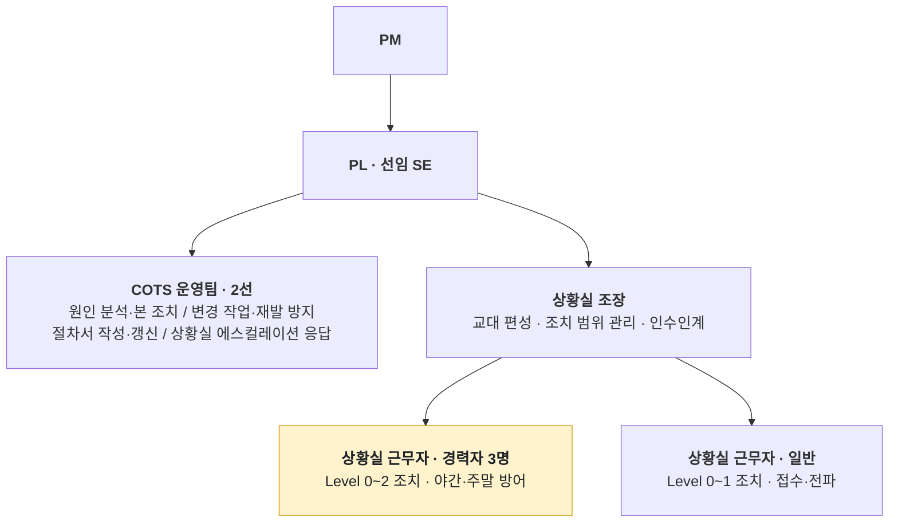
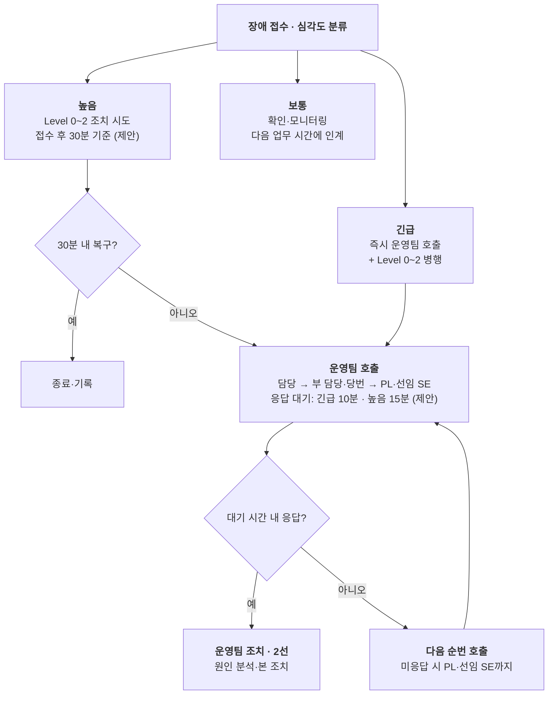

# COTS 운영팀 · 상황실 운영 R&R 정의서

2026-11-23 · 작성: 김동훈 · 문서 상태: v0.1 초안 (미승인)

**개정 관리**

- 개정 시점: 같은 유형의 이견이 반복될 때, 조직·도구가 바뀔 때, 정기 검토(제안: 분기 1회).
- 검토·승인: PL·선임 SE가 검토하고 PM이 승인한다(4장).

| 버전 | 일자 | 내용 | 승인 |
| --- | --- | --- | --- |
| v0.1 | 2026-11-23 | 초안 작성 | 미승인 |

> 상황실은 탐지·전파·절차서에 있는 응급 조치(1선)를, COTS 운영팀은 원인 분석·본 조치·변경·재발 방지(2선)를 맡고, 둘의 경계는 "승인된 조치 절차서에 있는가"로 판단한다. 상황실 경력자 3명은 일반 근무자보다 넓은 확장 조치 권한으로 야간·주말에 운영팀의 방어선 역할을 한다.

## 1. 문서 개요

이 문서는 장애 대응과 일상 운영에서 "어디까지가 누구의 업무인가"를 운영팀과 상황실이 같은 기준으로 판단하도록 역할과 책임(R&R)을 정의한다.

**목적**

- 운영팀·상황실 간 업무 경계 논쟁을 줄이고, 장애 시 초동 대응이 늦어지는 것을 막는다.
- 경력자 3명의 1선 조치 범위를 명확히 하여, 운영팀이 야간·주말에 즉시 조치하기 어려운 구간을 방어한다.

**적용 범위**

- 조직: PM, PL·선임 SE, COTS 운영팀(유지보수), 상황실 조장, 상황실 근무자(24시 시스템 관제)
- 업무: 장애 대응(탐지 → 접수 → 전파 → 조치 → 기록 → 사후 보고)을 중심으로 하고, 장애 외 업무의 구분도 함께 정한다.

**용어**

| 용어 | 정의 |
| --- | --- |
| 1선 | 상황실이 수행하는 단계: 탐지, 접수, 전파, 절차서 범위의 응급 조치 |
| 2선 | 운영팀이 수행하는 단계: 원인 분석, 본 조치, 변경 작업, 재발 방지 |
| 일반 근무자 | 상황실 초급 엔지니어. 상황 전파와 절차서에 등재된 응급 조치를 담당 |
| 경력자 | 상황실 근무자 중 1선 확장 조치 권한을 가진 3명 |
| 절차서 | 증상별 확인·조치 방법, 허용 대상과 범위, 호출 기준을 적은 승인 문서(현행 절차서·지식베이스 포함) |
| 응급 조치 | 서비스 영향의 확산을 막거나 줄이는, 되돌릴 수 있는 임시 조치 |
| 본 조치 | 원인을 제거하거나 정상 상태로 복구하는 조치(설정 변경, 패치, 재설치 등) |
| 에스컬레이션 | 정해진 기준에 따라 운영팀·상위 책임자에게 대응을 넘기거나 요청하는 것 |

응답 시간, 조치 허용 목록 같은 구체 값은 초안 제안이며, 합의가 필요한 항목은 11장에서 확정한다.

## 2. 조직 구성과 보고 체계

PM 아래 PL·선임 SE가 있고, 그 아래에서 COTS 운영팀과 상황실 조장이 동급으로 나뉜다. 상황실 근무자는 상황실 조장에게 보고한다.

*그림 1. 조직 구성도 (PM에서 상황실 근무자까지)*

> 경계 기준: 승인된 절차서에 있는 조치는 상황실(1선), 없거나 변경을 동반하는 조치는 운영팀(2선).
>
> 운영팀과 상황실 조장은 동급이며 서로 지시하지 않고, 요청·수락으로 업무를 주고받는다.

강조 표시한 경력자 3명은 일반 근무자와 같은 보고선에 있으면서 1선 조치 범위만 넓다(6장). 운영팀과 상황실 조장 사이의 이견은 PL·선임 SE가 조정한다(9장).

## 3. R&R 기본 원칙

여섯 가지 원칙 중 경계를 정하는 것은 2번이고, 나머지는 이 경계가 장애 중에 막히지 않게 하는 운영 규칙이다.

1. **장애 대응이 먼저, 책임 논쟁은 사후.** 장애 중에는 "내 업무인가"를 따지지 않는다. 다른 팀과 의견이 갈리면 조치를 멈추지 않고 9장의 판단 기준으로 진행한 뒤, 이견은 사후 절차(9장)로 넘긴다.
2. **경계는 절차서다.** 승인된 절차서에 있는 확인·응급 조치는 상황실이, 절차서에 없거나 설정 변경·재부팅 등 변경을 동반하는 조치는 운영팀이 맡는다.
3. **1선 우선.** 상황실은 운영팀을 호출하기 전에 자기 권한 범위의 확인과 조치를 먼저 수행한다. 호출할 때는 현상, 발생 시각, 영향 범위, 수행한 조치와 결과를 함께 전달한다.
4. **기준에 해당하면 시간을 가리지 않고 호출한다.** 야간·주말도 예외가 아니며, 기준에 맞는 호출은 정당한 업무로 본다.
5. **운영팀은 상황실이 일할 수 있게 만든다.** 절차서와 판단 기준을 제공하고, 호출에 정해진 시간 내 응답하며, 처리 결과를 상황실에 되돌려준다(재발 시 대응법 포함).
6. **한 일은 기록으로 남긴다.** 기록하지 않은 조치는 한 것으로 인정하지 않는다. 상황실은 접수부터 1선 조치까지, 운영팀은 원인·본 조치·재발 방지를 기록한다.

## 4. 역할별 책임

운영팀은 원인을 해결하는 2선, 상황실은 빠르게 발견하고 피해를 줄이는 1선이며, 경력자 3명은 1선을 더 넓게 수행하는 담당자다.

| 역할 | 맡는 일 | 결정 권한 |
| --- | --- | --- |
| PM | 사업 전체 책임, 중대 장애 시 대고객 협의, R&R 최종 승인 | R&R 승인, 대고객 공식 커뮤니케이션 |
| PL·선임 SE | R&R 운영 책임, 중대 장애 지휘와 기술 최종 판단, 절차서·조치 허용 목록 승인, 경력자 권한 부여, 운영팀·상황실 이견 조정 | 절차서·허용 목록 승인, 이견 최종 조정 |
| COTS 운영팀 | 2선: 원인 분석, 본 조치, 변경 작업, 재발 방지. 절차서 작성·갱신, 상황실 에스컬레이션 응답, 처리 결과 환류 | 변경 작업 승인·수행, 상황실 요청에 대한 조치 방향 결정 |
| 상황실 조장 | 상황실 운영 책임: 교대 편성, 근무자 조치 범위 관리, 에스컬레이션 판단 지원, 인수인계 품질, 운영팀 1차 창구 | 상황실 내 호출·전파 최종 판단 |
| 상황실 경력자(3명) | 1선 확장 조치 수행, 야간·주말 방어, 호출 전 원인 범위 좁히기 | 조치 허용 목록 Level 2까지 수행 |
| 상황실 일반 근무자 | 24시 모니터링, 알림 확인, 접수·등록, 상황 전파, 절차서의 응급 조치 | 조치 허용 목록 Level 0에서 Level 1(체크리스트 범위)까지 |

운영팀과 상황실 조장은 같은 PL·선임 SE 아래 동급이므로 서로 지시하지 않는다. 업무는 "요청 → 수락(또는 사유와 함께 거절)"로 주고받고, 이견이 해소되지 않으면 PL·선임 SE가 조정한다. Level 0~3의 정의는 6장에 있다.

## 5. 장애 대응 단계별 R&R

접수부터 1선 조치까지는 상황실 조장이, 원인 분석으로 넘어간 뒤는 운영팀이 최종 책임(A)을 진다. 단계마다 A는 한 곳뿐이다.

**R** 실행 · **A** 최종 책임 · **C** 사전 협의(의견·정보 제공) · **I** 결과 통보 · — 관여 없음

| 단계 | 일반 근무자 | 경력자 | 상황실 조장 | 운영팀 | PL·선임 SE |
| --- | --- | --- | --- | --- | --- |
| 1. 탐지·알림 확인 | R | R | A | I | — |
| 2. 접수·티켓 등록·초기 심각도 분류 | R | R | A | I | — |
| 3. 상황 전파(운영팀·관계자 통보) | R | R | A | I | I |
| 4. 1선 확인·응급 조치(Level 0~1) | R | R | A | I | — |
| 5. 1선 확장 조치(Level 2) | — | R | A | C | I |
| 6. 에스컬레이션 판단·호출 | R | R | A | I | I |
| 7. 원인 분석 | — | C | I | A/R | C |
| 8. 본 조치·변경 작업(Level 3) | — | — | I | A/R | C |
| 9. 진행 상황 갱신·전파 | R | R | A | C | I |
| 10. 접수~1선 조치 기록 | R | R | A | — | — |
| 11. 원인·본 조치·재발 방지 기록 | — | I | I | A/R | I |
| 12. 사후 보고(중대 장애 RCA) | — | C | C | R | A |
| 13. 절차서 작성·개정 | — | C | C | R | A |

A가 상황실 조장인 단계의 실행은 근무자가 하되 조치 범위는 6장의 허용 목록을 넘지 않는다. 운영팀이 A인 단계에서 상황실은 현상·시각·수행한 조치를 정확히 전달할 책임이 있다. 중대 장애에서는 PL·선임 SE가 지휘하고, 이 표의 책임자는 지휘자의 결정에 따른다.

## 6. 상황실 1선 조치 허용 범위

조치는 영향과 되돌릴 수 있는 정도에 따라 Level 0~3으로 나누고, 상황실은 Level 2까지(경력자), 운영팀은 Level 3을 맡는다. 예시는 초안이며 확정 목록은 현행 절차서·지식베이스를 기준으로 만들어 PL·선임 SE가 승인한다.

| Level | 성격 및 예시(확인 필요) | 일반 근무자 | 경력자 | 운영팀 |
| --- | --- | --- | --- | --- |
| 0. 조회·확인 | 영향 없음. 서버·서비스 상태, 지표·로그 조회, 알림 내용 확인 | 수행 | 수행 | — |
| 1. 표준 응급 조치 | 절차서에 등재, 영향이 작고 되돌릴 수 있음. 예: 알림 오탐 확인, 지정된 비핵심 서비스 재기동, 지정 경로 로그 정리 | 체크리스트대로 수행, 조장 확인 | 단독 수행 후 통보 | 운영팀 통보 수신 |
| 2. 확장 조치 | 절차서에 사례가 있으나 서비스 영향 가능. 예: 핵심 서비스 재기동, 지정 프로세스 종료 | 불가(경력자·조장에게 이관) | 운영팀 사전 협의(구두 가능, 기록 필수) 후 수행 | 협의 응답 |
| 3. 변경·위험 조치 | 설정·구성 변경, 재부팅, 패치, 데이터 삭제, 권한·방화벽 변경, DB 조작 | 불가 | 불가 | 수행 |

**예외 규칙.** 운영팀에 호출했으나 7장의 응답 대기 시간이 지났고 피해가 확산 중이면, 경력자는 되돌릴 수 있는 확산 방지 조치만 수행하고 PL·선임 SE에게 즉시 통보한다. 이 규칙의 허용 여부는 합의 필요 사항이다.

**금지 사항**

- 허용 목록 밖 조치를 사전 협의 없이 수행하지 않는다.
- 확인되지 않은 원인을 단정해 전파하지 않는다. 전파는 현상·시각·영향 범위 중심의 사실만 전달한다.
- 조치 내용을 기록하지 않고 종료하지 않는다.

## 7. 에스컬레이션 기준과 대응 시간

긴급 장애는 인지 즉시 운영팀을 호출하고, 높음 등급은 1선 조치를 먼저 시도한 뒤 정해진 시간 내 미복구이면 호출한다. 등급 기준과 시간은 초안 제안이며, 현행 알림 등급(온튀·Prometheus)과 매핑해 확정한다.

*그림 2. 에스컬레이션 흐름 (등급 3종, 판단 2회)*

긴급과 높음은 모두 운영팀 호출로 모이고, 보통은 호출 없이 다음 업무 시간에 인계한다. 응답이 없으면 다음 순번으로 넘어가며, 시간 값은 모두 제안이다.

| 등급 | 기준(예) | 1선 대응 | 운영팀 호출 시점(제안) | 상위 통보 |
| --- | --- | --- | --- | --- |
| 긴급 | 서비스 중단, 다수 서버 동시 영향, 고객 업무 영향 확인 | 인지 즉시 Level 0~2 조치 시작(호출과 병행) | 인지 즉시 | PL·선임 SE 동시 통보 |
| 높음 | 단일 서버 장애, 임계 초과 지속, 서비스 저하 | Level 0~2 조치 시도 | 접수 후 30분 내 미복구 시 | 미복구 장기화 시 PL·선임 SE |
| 보통 | 경고성 알림, 영향 없음 | 확인·모니터링, 필요 시 Level 1 | 호출 없음. 다음 업무 시간에 인계 | — |

**호출 순서와 응답 대기**

1. 담당 운영팀원(시스템·서버 담당표 기준)
2. 부 담당 또는 운영팀 당번
3. PL·선임 SE

호출 후 응답 대기 시간은 긴급 10분, 높음 15분(제안)이며, 지나면 다음 순번으로 넘어간다. PM 통보는 PL·선임 SE가 판단한다.

**호출 시 함께 전달할 내용**

- 현상과 발생 시각
- 영향 범위(서버·서비스·고객 영향 여부)
- 수행한 조치와 결과
- 운영팀에 요청하는 사항

## 8. 야간·주말·휴일 운영

야간·주말·휴일에는 경력자가 운영팀의 방어선이 되어 Level 2까지 조치를 시도하고, 호출 기준에 해당할 때만 운영팀을 부른다.

| 시간대 | 운영팀 상태 | 상황실 대응 |
| --- | --- | --- |
| 평일 주간(운영팀 근무시간) | 상주, 즉시 조치 가능 | 접수·전파 후 운영팀이 조치한다. 상황실은 Level 0~1 조치를 병행해 초동 시간을 줄인다. |
| 야간·주말·휴일 | 즉시 조치가 어렵거나 지연될 수 있음(호출 체계 확인 필요) | 경력자가 Level 2까지 조치를 시도하고, 호출 기준에 해당하면 운영팀을 호출한다. |

**운영팀 호출 기준** (하나라도 해당하면 호출)

1. 긴급 등급으로 분류된 장애
2. 경력자의 Level 2 조치 후에도 미복구(높음 등급은 접수 후 30분 기준)
3. Level 3 조치가 필요하다고 판단된 경우
4. 원인이 불명하고 영향이 확산되는 징후가 있는 경우

**배치와 인계**

- 야간·주말·휴일 근무조에 경력자를 1명 이상 배치한다(제안, 경력자 3명의 교대 편성 가능 여부 확인 필요).
- 경력자가 없는 근무조에서 Level 2가 필요하면, 일반 근무자는 상황실 조장 또는 운영팀에 즉시 요청한다.
- 야간·주말 조치 건은 다음 업무 시작 전에 현상·조치·결과·미해결 사항을 인수인계 양식으로 운영팀에 전달한다.
- 운영팀의 야간·주말 비상 연락 체계(당번표·연락 수단)는 현행 여부를 확인해 11장에서 확정한다.

## 9. 회색지대 판단 기준과 이견 조정

경계가 모호한 조치는 세 가지 질문으로 담당을 정하고, 그래도 의견이 갈리면 장애 중에는 조치를 먼저 진행한 뒤 사후에 PL·선임 SE가 조정한다.

**세 가지 질문**

1. 승인된 절차서에 있는 조치인가?
2. 서비스 영향이 있거나 되돌리기 어려운가?
3. 지금 처리하지 않으면 피해가 커지는가(시간 민감)?

| 절차서 | 영향·되돌리기 | 시간 민감 | 담당 |
| --- | --- | --- | --- |
| 있음 | 영향 작고 되돌릴 수 있음 | — | 상황실 수행(Level 1, 자격에 맞는 근무자) |
| 있음 | 영향 가능 | — | 경력자 수행, 운영팀 사전 협의(Level 2) |
| 없음 | 모름 또는 영향 있음 | 예 | 운영팀 호출. 응답이 없고 피해 확산 중이면 6장의 예외 규칙 |
| 없음 | 영향 없음 | 아니오 | 운영팀에 기록·인계 후, 다음 업무 시간에 처리 |

이 표에도 맞지 않는 상황은 "더 보수적인 쪽이 적용한다"는 원칙으로, 상황실은 호출을 선택하고 운영팀은 이를 거절하지 않는다.

**이견 조정 절차**

1. 장애 중: 상황실 조장이 현장 판단으로 진행하고, 이견 내용을 장애 기록에 남긴다(누가 무엇을 요구했는지).
2. 장애 후: 남긴 이견을 사례로 PL·선임 SE에게 제출한다(제안: 영업일 기준 이틀 이내).
3. PL·선임 SE가 담당을 결정하고, 결정을 절차서·허용 목록에 반영한다.
4. 같은 유형의 이견이 반복되면 사례가 아니라 규칙으로 바꿔 이 문서를 개정한다(11장).

## 10. 장애 외 업무 구분과 기록·보고

상황실은 관제·접수·전달을, 운영팀은 분석·변경·절차서 관리를 맡는다. 현행 업무 분담과 다른 부분은 11장에서 확인해 조정한다.

| 업무 | 상황실 | 운영팀 |
| --- | --- | --- |
| 24시간 모니터링·알림 확인 | 수행 | 오탐·누락 피드백 수신 |
| 장애 접수·등록·전파 | 수행 | 전파 수신, 응답 |
| 일일·정기 점검(현행 구분 확인 필요) | 육안 확인형 항목 수행 | 분석·판단형 항목 수행, 결과 리뷰 |
| 변경·패치·계획 작업 | 작업 시간 중 알림을 작업 이력과 대조(장애로 등록하지 않음) | 계획·수행, 작업 일정을 상황실에 사전 공유 |
| SR·VOC 등 요청 처리 | 접수·전달 | 처리 |
| 알림 규칙·임계값 조정 | 오탐·누락 사례 제공 | 조정 수행 |
| 절차서·지식베이스 관리 | 현장 피드백 제공 | 작성·갱신 |
| 교대 인수인계 | 수행(상황실 조장 책임) | 야간·주말 처리 건 수신 |

**기록 항목**

- 상황실: 접수 시각, 현상, 영향 범위, 초기 등급, 수행한 조치와 결과, 호출 시각·대상·응답 시각, 인계 사항
- 운영팀: 원인, 본 조치 내용, 재발 방지 방안, 절차서 반영 여부

**보고**

- 중대 장애는 운영팀이 사후 보고(RCA)를 작성하고 PL·선임 SE가 승인한다(5장).
- 일일·주간 보고의 주기와 양식은 현행을 따른다.

## 11. 합의 필요 사항과 문서 개정 관리

아래 9개 항목이 확정되어야 이 문서를 시행할 수 있다. 한 건씩 확정하며 체크한다.

- [ ] 심각도 등급 기준을 현행 알림 등급(온튀·Prometheus)과 매핑해 확정 (7장)
- [ ] 경력자 3명 지정과 조치 허용 목록(Level 1~3) 확정, PL·선임 SE 승인 (6장)
- [ ] 현행 절차서·지식베이스 현황 확인, 없는 항목의 작성 담당·기한 정하기 (1·6장)
- [ ] 운영팀 무응답 시 경력자의 확산 방지 조치(예외 규칙) 허용 여부 (6장)
- [ ] 호출·응답 시간 확정: 높음 등급 30분, 응답 대기 긴급 10분·높음 15분 (7장, 현재는 제안값)
- [ ] 운영팀 야간·주말 비상 연락 체계(당번표·연락 수단) 현행 여부 확인 (8장)
- [ ] 야간·주말 근무조에 경력자를 배치할 수 있는지 교대 편성 확인 (8장)
- [ ] 대고객 장애 안내 담당(PM·PL·상황실 조장 중) 확정 (4장)
- [ ] 일일·정기 점검의 현행 업무 구분 확인 (10장)

